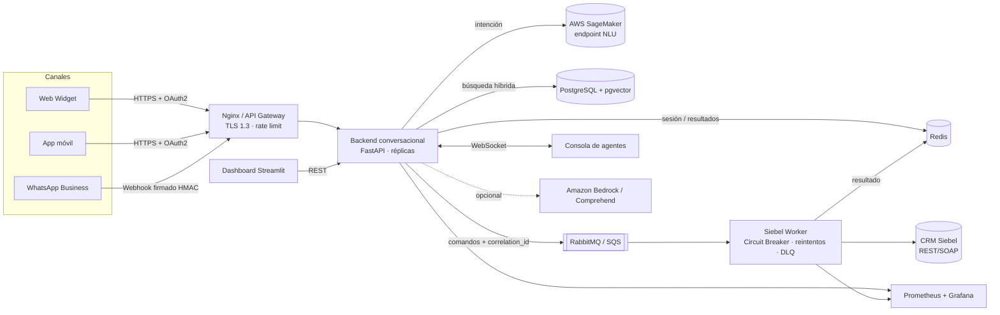

# TelecomBot AI — Chatbot inteligente para TelcoAustral

Proyecto semestral de **ITY1102 Arquitectura de Sistemas de Inteligencia Artificial** (Caso 2).
Implementación y despliegue (EP3).

**Equipo Hijos del wifi:** Diego Vásquez · Marcos San Martín

TelcoAustral tiene 500.000 clientes y el 80% de las llamadas al call center son consultas repetitivas
(saldo, boletas, planes), con 8 minutos de espera promedio. TelecomBot AI atiende esas consultas por
**Web Widget, WhatsApp y App móvil**, entiende **español chileno**, consulta el **CRM Siebel** de forma
asíncrona y **deriva a un ejecutivo** los casos complejos.

| Objetivo del caso | Cómo se aborda |
|---|---|
| Automatizar 60% de consultas repetitivas | NLU de 35 intenciones (F1 0,997) + RAG + Siebel; 59,5% de automatización en la simulación |
| Espera de 8 a 2 min | Respuesta automática en segundos; handoff con resumen para el agente |
| Latencia ≤ 3 s por interacción | p95 = 1,9 s con 300 usuarios concurrentes en AWS (ver `docs/pruebas.md`) |
| Español chileno | Normalizador de modismos + corpus de adaptación + set de evaluación manual |
| Siebel legacy | Cola de comandos (RabbitMQ/SQS) + worker + Circuit Breaker + DLQ |
| Piloto 10% | Asignación determinista por usuario; el 90% restante va al canal tradicional |
| Ley 19.628 / GDPR | PII enmascarada en logs, mensajes cifrados, seudónimos, exportación y derecho al olvido |

## Arquitectura



Más detalle (secuencias, decisiones y trazabilidad con la EP2) en [`docs/arquitectura.md`](docs/arquitectura.md).

## Estructura

La organización del código sigue la vista de bloques Nivel 3 de la EP2 (§5.3):

```
app/
  api/controllers.py          endpoints REST, webhooks, WebSockets (Swagger en /docs)
  api/security.py             OAuth2 client credentials / OIDC, scopes
  channels/normalizer.py      Web, WhatsApp y App al contrato interno
  conversation/session_service.py   sesión y contexto (Redis), piloto 10%
  conversation/router.py      política: RAG, Siebel, handoff, aclaración
  conversation/engine.py      orquestación del turno completo
  nlp/                        normalizador chileno, intenciones, clasificador (local/SageMaker), sentimiento
  rag/                        base de conocimiento, embeddings, retriever pgvector, orquestador + guardrails
  integrations/               cola, Circuit Breaker, cliente y publicador de Siebel
  handoff/service.py          derivación a agentes por WebSocket (fan-out con Redis Pub/Sub)
  observability/telemetry.py  métricas Prometheus, logs JSON con correlation_id y sin PII
  persistence/                Redis (KV) y PostgreSQL (modelo de dominio)
  workers/siebel_worker.py    consumidor de la cola de Siebel
  siebel_mock/                simulador del CRM (REST + SOAP + modo caos)
  static/                     Web Widget y consola de agentes
training/                     carga de Bitext, corpus es-CL y entrenamiento
aws/                          Training Job + endpoint SageMaker, reporte CloudWatch
dashboard/                    dashboard Streamlit
k8s/                          manifiestos Kubernetes (EKS/Minikube): HPA, PDB, anti-afinidad
loadtest/                     pruebas de carga con Locust
monitoring/                   Prometheus (alertas) y Grafana (dashboard provisionado)
tests/                        21 casos de prueba unitarios y de integración
```

## Inicio rápido (local, sin Docker)

```bash
python -m venv .venv && source .venv/bin/activate
make install
make train                 # sin data/bitext.csv usa una muestra sintética con el mismo esquema
make test                  # 21 pruebas
make run                   # http://localhost:8000/widget  ·  /docs  ·  /agent
make dashboard             # en otra terminal: http://localhost:8501
```

Para entrenar con el dataset real, descárgalo según [`data/README.md`](data/README.md) y ejecuta
`make train BITEXT=data/bitext.csv`.

## Despliegue en AWS (AWS Academy)

Guía paso a paso en [`docs/despliegue-aws.md`](docs/despliegue-aws.md). En resumen:

```bash
make train BITEXT=data/bitext.csv
make deploy-sm BUCKET=telecombot-<equipo>     # Training Job + endpoint SageMaker con auto-scaling
# en la EC2:
./infra/ec2-setup.sh && docker compose up -d --build
```

| URL | Qué es |
|---|---|
| `https://<IP>/widget` | Web Widget del cliente |
| `https://<IP>/docs` | API REST (Swagger / OpenAPI) |
| `https://<IP>/dashboard/` | Dashboard de KPIs, interpretabilidad y operación |
| `https://<IP>/agent` | Consola de agentes (handoff) |

## Ejemplo con curl

```bash
TOKEN=$(curl -sk -X POST https://<IP>/oauth/token -d grant_type=client_credentials \
  -d client_id=mobile-app -d client_secret=<secreto> | jq -r .access_token)

curl -sk -X POST https://<IP>/api/v1/chat/messages -H "Authorization: Bearer $TOKEN" \
  -H 'Content-Type: application/json' \
  -d '{"user_id":"demo","customer_id":"C-1001","text":"wena, cuánto debo de la boleta?"}' | jq
```

Hay una colección de Postman lista en [`docs/postman_collection.json`](docs/postman_collection.json).

## Documentación

- [`docs/arquitectura.md`](docs/arquitectura.md): componentes, secuencias, decisiones y trazabilidad con la EP2
- [`docs/despliegue-aws.md`](docs/despliegue-aws.md): SageMaker, EC2, costos y limpieza
- [`docs/pruebas.md`](docs/pruebas.md): casos de prueba, métricas del modelo y pruebas de carga
- [`docs/demo.md`](docs/demo.md): guion de la demostración en vivo
