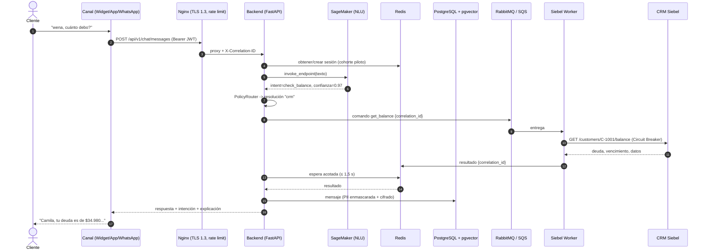
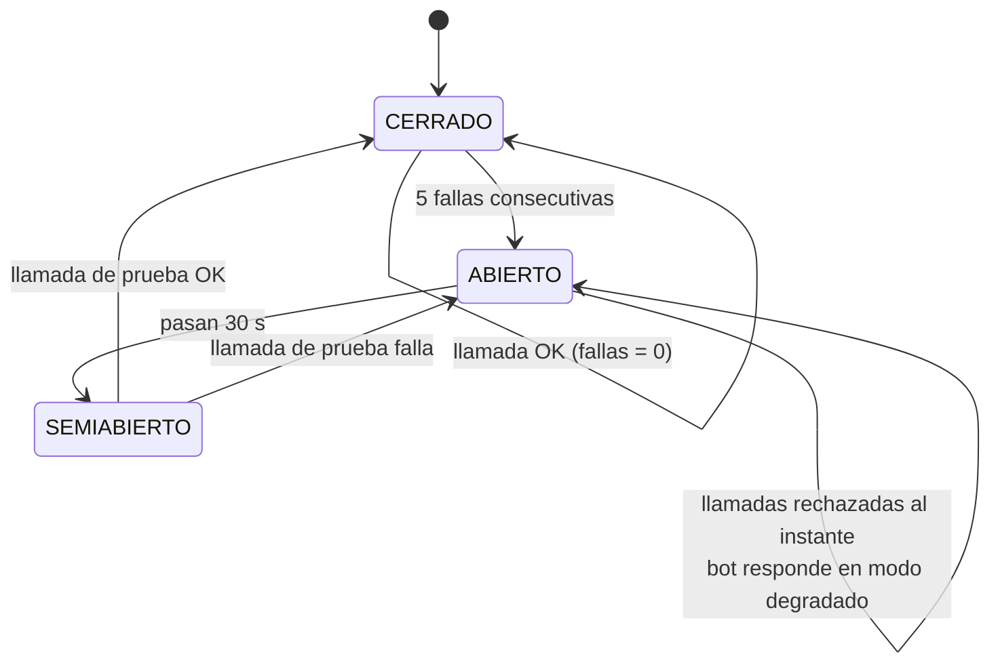
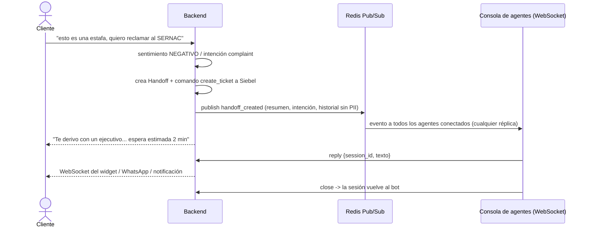

# Arquitectura implementada — TelecomBot AI

Este documento describe lo que efectivamente se implementó en la EP3 y cómo se relaciona con la
arquitectura arc42 entregada en la EP2.

## 1. Flujo de un turno conversacional

Si Siebel no responde en 1,5 s, el bot contesta *"Estoy consultando tu información, te la envío en
un momento"* y el worker deja el resultado como notificación de la sesión cuando llega
(`GET /api/v1/chat/sessions/{id}/updates`). El mensaje no se pierde (cola persistente, RPO = 0).

## 2. Siebel caído: Circuit Breaker

- Lecturas: timeout de 1 s, 3 reintentos con backoff exponencial (0,1 s, 0,2 s, 0,4 s).
- Escrituras (crear caso): sin reintento inmediato. Se re-encolan con backoff (1, 2, 4 s…) y al agotar
  los intentos van a la **Dead-Letter Queue** para reprocesarlas.
- El estado del circuito y el contador de fallas viven en **Redis** (operaciones atómicas): todas las
  réplicas del worker comparten el mismo circuito, y un candado en Redis garantiza una sola llamada de
  prueba en estado semiabierto. El backend no espera timeouts si ya sabe que Siebel está caído, y el
  dashboard muestra el estado.
- Las consultas que llegan con el circuito abierto se responden al instante en modo degradado (~10 ms)
  y quedan en cola; el worker las reintenta con backoff hasta que Siebel se recupera y entrega el
  resultado como notificación de la sesión (lo que el bot le prometió al cliente).
- El simulador de Siebel tiene un **modo caos** (`POST /admin/chaos`) para mostrarlo en la defensa.

## 3. Handoff a un ejecutivo

Motivos de derivación: intención `contact_human_agent`, `complaint` o `delete_account` (retención),
cliente molesto (léxico chileno o Amazon Comprehend), dos turnos seguidos bajo el umbral de confianza,
y usuarios fuera del piloto del 10%.

## 4. NLP en español chileno

1. **Normalización** (`app/nlp/normalizer_cl.py`): minúsculas, sin tildes, letras repetidas
   ("holaaa"), modismos ("wena", "cachai", "altiro", "lucas", "celu", "megas") y abreviaturas de chat
   ("q", "xq", "kiero"). Los insultos se convierten en un marcador que usa el análisis de sentimiento.
2. **Clasificador** (`app/nlp/model_def.py`): TF-IDF de palabras (1-2 gramas) + TF-IDF de caracteres
   (2-5 gramas) y Regresión Logística multinomial. Los n-gramas de caracteres hacen al modelo robusto a
   faltas de ortografía.
3. **Datos**: las 27 intenciones de Bitext (inglés) + corpus de adaptación al español chileno para
   telecomunicaciones (35 intenciones en total). La evaluación en español usa un set escrito a mano
   (`data/eval_es_cl.csv`), distinto de las plantillas de entrenamiento.
4. **Interpretabilidad**: cada respuesta incluye las 3 intenciones más probables y los n-gramas que más
   pesaron (coeficiente × TF-IDF). El RAG devuelve los documentos usados como fuente.

### ¿Por qué un modelo lineal y no un LLM para el NLU?

| Criterio | TF-IDF + Regresión Logística | LLM para clasificar |
|---|---|---|
| Latencia | ~1-2 ms en CPU | 300-1.500 ms |
| Costo por consulta | ~0 (endpoint ml.t2.medium) | por token |
| Interpretabilidad | pesos por n-grama | baja |
| Umbral de confianza | probabilidades estables | no calibrado |

El LLM (Bedrock) queda reservado para **redactar** respuestas con el contexto recuperado, que es
donde aporta valor, y con fallback extractivo si excede 2 s.

## 5. RAG

- Base de conocimiento: `data/kb/telcoaustral_kb.json` (33 artículos con intenciones asociadas).
- Embeddings LSA de 128 dimensiones, indexados en **pgvector con HNSW** (distancia coseno).
- Re-ranking híbrido: `0,65 · semántico + 0,35 · léxico + 0,15 si coincide la intención`.
- Guardrails: si el mejor documento tiene puntaje < `RAG_MIN_SCORE` no se responde "inventando", se
  ofrece un ejecutivo. La pregunta llega al LLM con PII enmascarada y el prompt obliga a usar solo el
  contexto.

## 6. Seguridad y cumplimiento

| Control | Implementación |
|---|---|
| Autenticación | OAuth2 client credentials (`/oauth/token`) con scopes por cliente; token anónimo de 30 min para el widget; soporte OIDC/Cognito (RS256 + JWKS) |
| Autorización | scopes `chat:write`, `agent`, `metrics:read`, `admin` (mínimo privilegio) |
| Cifrado en tránsito | Nginx con **TLS 1.3** únicamente + HSTS |
| Cifrado en reposo | mensajes cifrados con Fernet (AES-128-CBC + HMAC); S3 con SSE-KMS |
| PII | enmascarado de RUT, correo, teléfono y tarjeta en logs, BD y prompts; IDs seudonimizados con HMAC-SHA256 |
| Secretos | credenciales de Siebel desde AWS Secrets Manager (`SIEBEL_SECRET_ARN`) |
| Webhooks | WhatsApp verificado con `X-Hub-Signature-256` (HMAC) |
| Rate limiting | Nginx por IP + backend por cliente OAuth2/token |
| GDPR / Ley 19.628 | `GET` y `DELETE /api/v1/privacy/users/{id}` (acceso y supresión) |
| Contenedores | usuario no root, imágenes slim, escaneo Trivy en CI |

## 7. Observabilidad

Métricas Prometheus (`/metrics`): latencia por turno y por etapa (NLU, RAG, LLM, Siebel), intenciones,
resoluciones, handoffs por motivo, resultados de Siebel, estado del circuito y WebSockets activos.
Alertas en `monitoring/alerts.yml`: P95 > 2,5 s, tasa de handoff > 40%, circuito abierto, 5xx > 1%.
Todos los logs son JSON con `correlation_id` y pasan por un filtro de PII.

## 8. Trazabilidad con la EP2

| EP2 | Implementación EP3 |
|---|---|
| RF01 multicanal | `app/channels/` + `/webhooks/whatsapp` + `/widget` + REST para la app |
| RF02 contexto de sesión | `conversation/session_service.py` (Redis, TTL 30 min) |
| RF03 español chileno | `nlp/normalizer_cl.py`, `training/spanish_cl.py`, `data/eval_es_cl.csv` |
| RF04 RAG + base vectorial | `rag/` + pgvector |
| RF05 consulta a Siebel | `integrations/` + `workers/siebel_worker.py` |
| RF06 handoff | `handoff/service.py` + `/ws/agents` |
| RF07 trazas y auditoría | `observability/telemetry.py`, tabla `mensajes` y `operaciones_siebel` |
| RNF01 ≤ 3 s | p95 210 ms con 500 usuarios (local); espera acotada a Siebel de 1,5 s |
| RNF03 1.000 conversaciones | HPA 3-10 réplicas (k8s), prueba de carga con Locust |
| RNF04 Ley 19.628 / GDPR | sección 6 |
| RNF05 piloto 10% | `pilot_cohort()` determinista por usuario |
| ADR-003 SQS + worker + CB | `QUEUE_BACKEND=sqs` o `rabbitmq` (misma interfaz) |
| ADR-004 Bedrock | `LLM_PROVIDER=bedrock` (LangChain), con fallback extractivo |
| ADR-006 Multi-AZ + anti-afinidad | `k8s/10-backend.yaml` |

### Ajustes respecto de la EP2

- **Cola**: la EP2 eligió SQS, pero la rúbrica de la EP3 pide RabbitMQ/Kafka. Se implementó una interfaz
  común (`integrations/queue.py`): RabbitMQ en el despliegue del piloto y SQS configurable para EKS.
- **SageMaker**: la EP3 exige desplegar el modelo en SageMaker. Se despliega el clasificador de
  intenciones (Training Job + endpoint con auto-scaling); el backend lo invoca y usa el modelo local como
  respaldo si el endpoint no responde.
- **EKS → EC2 + Docker Compose para el piloto**: AWS Academy limita EKS, por lo que la demo corre en una
  EC2. Los manifiestos de `k8s/` mantienen el diseño de la EP2 para producción.
